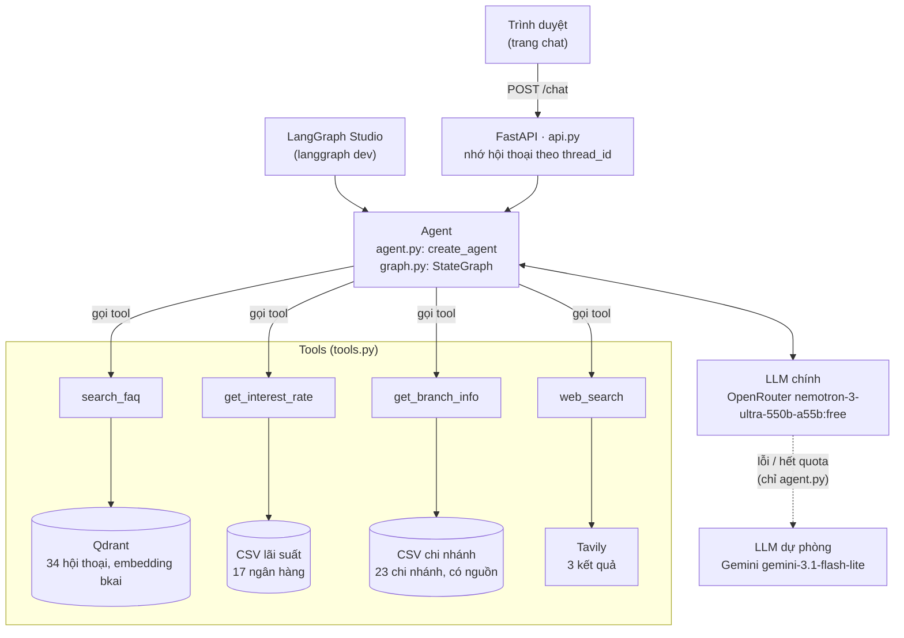

# bank-faqs

Agent chăm sóc khách hàng (CSKH) ngân hàng bằng tiếng Việt, xây dựng với LangChain/LangGraph. Agent trả lời câu hỏi về thẻ, tài khoản, chuyển tiền, tiết kiệm, vay, lừa đảo, ứng dụng ngân hàng, lãi suất tiết kiệm và địa chỉ chi nhánh tại Quy Nhơn.

- Câu trả lời dựa trên **dữ liệu nội bộ**: 34 hội thoại CSKH mẫu (tìm bằng vector search trong Qdrant), bảng lãi suất của 17 ngân hàng và danh sách 23 chi nhánh. Agent chỉ tìm trên web khi dữ liệu nội bộ không có câu trả lời.
- Có **web chat** (FastAPI) chạy bằng Docker, nhớ ngữ cảnh hội thoại.
- LLM chính là OpenRouter (`nvidia/nemotron-3-ultra-550b-a55b:free`). Khi OpenRouter lỗi hoặc hết quota, agent **tự chuyển sang Gemini**.
- Có **65 test** (không gọi API thật) và **bộ eval 37 câu** để đo chất lượng câu trả lời.

Chạy nhanh (cần Docker và file `.env`, xem [Cài đặt](#cài-đặt)):

```bash
docker compose up -d --build   # build image, chạy Qdrant + web app, tự nạp dữ liệu
# mở http://localhost:8000
```

## Mục lục

- [Cách hoạt động](#cách-hoạt-động)
- [Các tool](#các-tool)
- [Dữ liệu](#dữ-liệu)
- [Cấu trúc thư mục](#cấu-trúc-thư-mục)
- [Yêu cầu](#yêu-cầu)
- [Cài đặt](#cài-đặt)
- [Deploy bằng Docker](#deploy-bằng-docker)
- [Chạy trên máy không dùng Docker](#chạy-trên-máy-không-dùng-docker)
- [Web app và API](#web-app-và-api)
- [Test](#test)
- [Đánh giá (eval)](#đánh-giá-eval)
- [Giới hạn của LLM (gói free)](#giới-hạn-của-llm-gói-free)
- [Mở rộng dự án](#mở-rộng-dự-án)
- [Xử lý sự cố](#xử-lý-sự-cố)
- [Lưu ý về dữ liệu chi nhánh](#lưu-ý-về-dữ-liệu-chi-nhánh)
- [Lưu ý trên Windows](#lưu-ý-trên-windows)

## Cách hoạt động



### Luồng xử lý một câu hỏi

1. Trang chat gửi `POST /chat` với `message` và `thread_id` (bỏ trống ở tin nhắn đầu tiên).
2. `api.py` lấy lịch sử của `thread_id` từ bộ nhớ (`InMemorySaver`), thêm tin nhắn mới rồi gọi agent.
3. Trước mỗi lần gọi LLM, `history.py` **cắt bớt lịch sử** gửi đi: chỉ giữ 4 lượt hỏi gần nhất, kết quả tool của các lượt cũ rút còn 300 ký tự. State trong bộ nhớ vẫn giữ đầy đủ.
4. LLM đọc system prompt (`prompts.py`) và mô tả các tool (docstring của hàm `@tool` trong `tools.py`), rồi quyết định gọi tool nào. Agent có thể gọi nhiều tool liên tiếp trong một lượt.
5. Tool trả kết quả dạng văn bản. LLM soạn câu trả lời chỉ dựa trên kết quả đó.
6. Nếu OpenRouter lỗi (hết quota, quá tải, mất kết nối…), lần gọi đó được chuyển sang Gemini (`ModelFallbackMiddleware`).
7. API trả về `answer`, `thread_id` và danh sách `tools` đã gọi trong lượt này. Trang chat hiển thị câu trả lời, link bấm được và dòng "Đã tra cứu: …".

### Quy tắc của agent

System prompt nằm trong `src/bank_faqs/prompts.py` (`AGENT_PROMPTS['agent_main']`), gồm 12 quy tắc:

| Nhóm | Quy tắc |
|---|---|
| Xưng hô | Luôn trả lời tiếng Việt, lịch sự, xưng "em", gọi khách là "anh/chị", không đoán giới tính của khách |
| Dùng tool | (1) Thủ tục, thẻ, tài khoản, chuyển tiền, tiết kiệm, vay, lừa đảo → gọi `search_faq` trước. (2) Lãi suất tiết kiệm → `get_interest_rate`, nêu ngày cập nhật. (3) Chi nhánh, địa chỉ, số điện thoại → `get_branch_info`, mỗi chi nhánh kèm link nguồn. (4) Chỉ gọi `web_search` khi các tool trên không có câu trả lời. (5) Xem kết quả các lần gọi trước xem đã đủ thông tin chưa rồi mới gọi tiếp |
| Trả lời | (6) Chỉ dựa trên kết quả tool, không tự đoán phí, hạn mức, lãi suất, số điện thoại, giờ làm việc. (7) Không tìm thấy thì nói rõ là chưa có thông tin và hướng dẫn khách xem trên app hoặc liên hệ chi nhánh. (8) Ngắn gọn, tối đa khoảng 80 từ (không tính phần nguồn); có nhiều bước thì liệt kê theo thứ tự |
| Chuyển nhân viên | (9) Khách bị lừa đảo, mất tiền, bị khóa tài khoản, khó khăn trả nợ, hoặc muốn gặp người thật: hướng dẫn bước khẩn cấp (vd khóa thẻ) rồi báo sẽ chuyển nhân viên |
| Bảo mật | (10) Không bao giờ hỏi OTP, mật khẩu, mã PIN. (11) Không cung cấp thông tin tài khoản của người khác |
| Ngoài phạm vi | (12) Không tư vấn đầu tư (vàng, cổ phiếu, tiền số…) hay chủ đề không liên quan dịch vụ ngân hàng: không gọi tool, từ chối trong 1–2 câu, hỏi khách có cần hỗ trợ khác không |

`agent.py` (`create_agent`) và `graph.py` (`StateGraph` tự dựng: `model → tools → model … → END`) dùng chung LLM, tool, system prompt và cách cắt lịch sử. Hai bản chỉ khác cách dựng; riêng `agent.py` có Gemini dự phòng. Web app dùng `agent.py`.

## Các tool

| Tool | Nguồn dữ liệu | Dùng khi |
|---|---|---|
| `search_faq(query)` | Qdrant, top 3 hội thoại tương tự | Thủ tục, xử lý sự cố |
| `get_interest_rate(bank='')` | `data/raw/lai_suat_ngan_hang_23-10-2026.csv` | Lãi suất tiết kiệm online/tại quầy, kỳ hạn 1–36 tháng |
| `get_branch_info(bank='', street='')` | `data/raw/chi_nhanh_ngan_hang_quy_nhon.csv` | Địa chỉ, số điện thoại chi nhánh tại Quy Nhơn |
| `web_search(query)` | Tavily, 3 kết quả, timeout 30 giây | Khuyến mãi, tin tức, lãi suất vay, ngân hàng không có trong dữ liệu |

**`search_faq`**: embedding câu hỏi của khách, tìm 3 hội thoại có câu hỏi gần nhất trong Qdrant, rồi trả về từng cặp `Hỏi: … / Đáp: …`. Không tìm thấy thì trả "Không tìm thấy câu trả lời trong dữ liệu nội bộ."

**`get_interest_rate`**:
- Để trống `bank`: trả bảng lãi suất **online** của cả 17 ngân hàng, dùng khi khách hỏi so sánh hoặc hỏi ngân hàng nào cao nhất.
- Có `bank`: trả lãi suất online và tại quầy, kỳ hạn 1, 3, 6, 12, 18, 24, 36 tháng, kèm ngày cập nhật. Ví dụ `get_interest_rate('bidv')`:
  ```
  BIDV (cập nhật 23/10/2026, T = tháng):
  - Online: 1T 4.8%, 3T 4.8%, 6T 7.2%, 12T 7.4%, 18T 6.6%, 24T 6.8%, 36T 6.8%
  - Tại quầy: 1T 2.1%, 3T 2.4%, 6T 3.5%, 12T 5.9%, 18T 5.9%, 24T 6%, 36T 6%
  ```
- Kỳ hạn không có số liệu thì ghi "không có". Ngân hàng không có trong dữ liệu thì trả danh sách các ngân hàng đang có.

**`get_branch_info`**: lọc theo ngân hàng và/hoặc tên đường; để trống cả hai thì lấy cả 23 chi nhánh. Mỗi chi nhánh có: địa chỉ theo nguồn, phường mới (sau sáp nhập 1/7/2025), điện thoại, giờ làm việc, **độ tin cậy** và **URL nguồn** (có thể nhiều URL). Kết quả kèm lời dặn model phải ghi nguồn và không tự bổ sung thông tin còn thiếu. Ô ghi "Chưa có nguồn" hoặc để trống được trả về là "chưa có thông tin", để model không tự bịa.

**Nhận diện tên ngân hàng** (dùng cho `get_interest_rate` và `get_branch_info`):
1. Chuẩn hóa: chữ thường, bỏ dấu (`đ` → `d`), bỏ ký tự không phải chữ/số, bỏ tiền tố "ngân hàng". Ví dụ "Ngân hàng Bắc Á" → `baca`.
2. Đổi tên gọi tắt sang tên chuẩn theo `BANK_ALIASES` trong `tools.py` (`baca` → `bacabank`, `vcb` → `vietcombank`, `ctg`/`vietin` → `vietinbank`, `mb`/`quandoi` → `mbbank`, `tcb` → `techcombank`…).
3. Ưu tiên khớp chính xác. Nếu không khớp chính xác và tên dài từ 3 ký tự trở lên thì khớp một phần (vd `oceanbank` khớp "MBV (OceanBank cũ)").

Tên đường cũng được so khớp không dấu: `le duan` khớp "Lê Duẩn".

**Xử lý lỗi:** `search_faq` và `web_search` tự bắt lỗi (Qdrant sập, Tavily timeout…) và trả lời cho model là đang lỗi hệ thống, dặn model không tự đưa ra hướng dẫn hay số liệu. Nhờ vậy cả lượt hội thoại không bị hỏng: `ToolNode` của LangGraph chỉ tự bắt lỗi sai tham số, lỗi khác sẽ làm hỏng lượt đó.

## Dữ liệu

| File | Số dòng | Dùng bởi |
|---|---|---|
| `data/raw/cskh_hoi_thoai_ngan_hang.csv` | 94 lượt nói / 34 hội thoại | `data_prep.py` (đầu vào) |
| `data/processed/cskh_gop_theo_id.csv` | 34 hội thoại | `vector_db.py` (nạp vào Qdrant), eval |
| `data/raw/lai_suat_ngan_hang_23-10-2026.csv` | 17 ngân hàng | `get_interest_rate` |
| `data/raw/chi_nhanh_ngan_hang_quy_nhon.csv` | 23 chi nhánh / 18 ngân hàng | `get_branch_info` |

Mọi file đều là CSV UTF-8 có BOM (`utf-8-sig`), mở bằng Excel không lỗi font.

### Hội thoại CSKH

`cskh_hoi_thoai_ngan_hang.csv`: mỗi dòng là một lượt nói.

| Cột | Ý nghĩa | Ví dụ |
|---|---|---|
| `hoi_thoai_id` | Mã hội thoại | `HT001` |
| `luot` | Thứ tự lượt nói trong hội thoại | `1`, `2`, `3` |
| `vai_tro` | `khach_hang` hoặc `nhan_vien` | `khach_hang` |
| `noi_dung` | Nội dung lượt nói | "ơi mình bị mất ví, trong đó có thẻ atm, giờ sao đây" |
| `chu_de` | 11 chủ đề: Thẻ, Ngân hàng số, Tài khoản, Chuyển tiền, Tiết kiệm, Vay vốn, Bảo mật, Khiếu nại, Điểm giao dịch, Ngoài phạm vi, Khác | `Thẻ` |
| `y_dinh` | Ý định của khách | `khoa_the_mat_the` |
| `cam_xuc_khach` | Lo lắng, Bực bội, Hoảng sợ, Tức giận, Nghi ngờ, Thắc mắc, Bình thường, Hài lòng | `Lo lắng` |
| `can_chuyen_nhan_vien` | `Có` / `Không` | `Không` |
| `ghi_chu` | Ghi chú cho người viết dữ liệu | "Ưu tiên khóa thẻ ngay" |

`data_prep.py` gộp mỗi hội thoại thành một dòng trong `cskh_gop_theo_id.csv`, gồm 4 cột: `hoi_thoai_id`; `question` (các lượt của khách nối lại); `answer` (các lượt của nhân viên nối lại); `chu_de`. Ba cột `y_dinh`, `cam_xuc_khach`, `can_chuyen_nhan_vien` hiện **chưa dùng**. Có thể dùng sau này, ví dụ để lọc theo chủ đề hoặc làm nhãn cho eval.

**Embedding và Qdrant** (`vector_db.py`):
- Chỉ **câu hỏi** (`question`) được embedding; `answer`, `chu_de` và `hoi_thoai_id` lưu trong metadata. Khi tìm kiếm, câu hỏi của khách được so với câu hỏi mẫu, rồi trả về câu trả lời đi kèm.
- Văn bản được tách từ tiếng Việt bằng `pyvi` (vd "tài khoản" → "tài_khoản"), rồi embedding bằng `bkai-foundation-models/vietnamese-bi-encoder` (vector 768 chiều, chuẩn hóa), so khớp bằng cosine.
- Collection tên `cskh_bkai`. ID của mỗi điểm là `uuid5(hoi_thoai_id)`, nên nạp lại thì ghi đè chứ không tạo bản trùng.

### Lãi suất

`lai_suat_ngan_hang_23-10-2026.csv`: mỗi dòng một ngân hàng, gồm cột `Mã NH`; 7 cột `Online {1,3,6,12,18,24,36}T (%/năm)`; 7 cột `Tại quầy {…}T (%/năm)`. Ô trống là ngân hàng không công bố kỳ hạn đó (2 ngân hàng không có kỳ hạn 18–36 tháng). Hai cột `Số CN đã thu thập ở Quy Nhơn` và `Online 12T cao nhất?` chỉ để tham khảo, tool không dùng.

### Chi nhánh

`chi_nhanh_ngan_hang_quy_nhon.csv`: `Mã NH`, `Tên ngân hàng`, `Đơn vị` (vd "CN Quy Nhơn"), `Loại`, `Địa chỉ (theo nguồn)`, `Phường mới (sau 1/7/2025)`, `Điện thoại`, `Giờ làm việc`, `Ghi chú / độ tin cậy`, `Nguồn` (một hoặc nhiều URL, cách nhau bằng `;`). `Mã NH` phải trùng với file lãi suất để cả hai tool nhận diện cùng một tên ngân hàng. Xem thêm [Lưu ý về dữ liệu chi nhánh](#lưu-ý-về-dữ-liệu-chi-nhánh).

### Cập nhật dữ liệu

| Dữ liệu | Cách cập nhật | Cần làm thêm |
|---|---|---|
| Lãi suất | Đặt file CSV mới vào `data/raw/` (giữ nguyên tên cột) | Sửa `RATE_FILE` và `RATE_DATE` trong `config.py`; build lại image nếu chạy Docker |
| Chi nhánh | Sửa trực tiếp `chi_nhanh_ngan_hang_quy_nhon.csv` (giữ nguyên tên cột). Ô chưa có dữ liệu thì ghi "Chưa có nguồn" hoặc để trống | Build lại image nếu chạy Docker |
| Hội thoại CSKH | Sửa `cskh_hoi_thoai_ngan_hang.csv` | Chạy `data_prep` rồi `vector_db` ([bước 2](#chạy-trên-máy-không-dùng-docker)). Docker: build lại image rồi chạy `docker compose down -v && docker compose up -d`, vì API chỉ tự nạp khi collection rỗng |

Sau khi đổi dữ liệu hội thoại, chạy `uv run pytest tests/test_eval_dataset.py` để chắc các `faq_id` trong bộ eval vẫn tồn tại.

## Cấu trúc thư mục

```
bank_faqs/
├── data/
│   ├── raw/                                  # Dữ liệu gốc
│   │   ├── cskh_hoi_thoai_ngan_hang.csv      # Hội thoại CSKH, mỗi dòng là 1 lượt nói
│   │   ├── lai_suat_ngan_hang_23-10-2026.csv # Lãi suất tiết kiệm 17 ngân hàng (get_interest_rate)
│   │   └── chi_nhanh_ngan_hang_quy_nhon.csv  # 23 chi nhánh tại Quy Nhơn, có nguồn (get_branch_info)
│   └── processed/
│       └── cskh_gop_theo_id.csv              # Hội thoại đã gộp theo id, sinh bởi data_prep.py, nạp vào Qdrant
├── src/bank_faqs/
│   ├── __init__.py       # Khởi tạo chung: fix DLL torch (Windows), dùng kho chứng chỉ hệ thống, nạp .env
│   ├── config.py         # Đường dẫn dữ liệu, cấu hình Qdrant/embedding, biến môi trường
│   ├── llm.py            # Cấu hình LLM: open_llm (OpenRouter, đang dùng), google_llm (Gemini: dự phòng + judge), groq_llm (Groq)
│   ├── prompts.py        # System prompt của từng agent
│   ├── tools.py          # 4 tool + gán tool cho từng agent
│   ├── history.py        # Cắt bớt lịch sử hội thoại trước khi gửi model
│   ├── agent.py          # Agent dựng bằng create_agent (LangChain) + Gemini dự phòng; chạy thử 4 câu hỏi mẫu
│   ├── graph.py          # Cùng agent đó nhưng tự dựng bằng StateGraph (LangGraph)
│   ├── data_prep.py      # Gộp các lượt hội thoại theo id -> data/processed/
│   ├── vector_db.py      # Embedding bkai + Qdrant, nạp dữ liệu
│   ├── api.py            # Web app FastAPI: trang chat + POST /chat + /health
│   └── static/index.html # Giao diện chat
├── tests/                # pytest (65 test, không gọi API thật)
├── evals/                # Đánh giá chất lượng agent
│   ├── dataset.jsonl     # 37 câu hỏi kèm tool mong đợi, từ khóa, tiêu chí chấm
│   ├── run_eval.py       # Script chấm truy xuất + agent
│   └── results/          # Kết quả từng lần chạy (JSON), không commit
├── certs/                # CA nội bộ (*.crt) cho mạng có SSL inspection, không commit
├── .env                  # API key, không commit (xem Cài đặt)
├── Dockerfile            # Image cho web app
├── docker-compose.yml    # Qdrant + web app
├── langgraph.json        # Cấu hình cho `langgraph dev`
├── pyproject.toml        # Thư viện (nguồn chính, cùng uv.lock)
└── requirements.txt      # Danh sách thư viện cho pip, phải khớp pyproject.toml (có test kiểm tra)
```

## Yêu cầu

- Python 3.12.15 (ghi trong `.python-version`) và [uv](https://docs.astral.sh/uv/)
- Docker, để chạy Qdrant và web app
- API key:

| Key | Lấy ở đâu | Dùng cho | Bắt buộc |
|---|---|---|---|
| `OPENROUTER_API_KEY` | [openrouter.ai/keys](https://openrouter.ai/keys) | LLM chính của agent | Có |
| `GOOGLE_API_KEY` | [Google AI Studio](https://aistudio.google.com/apikey) | Gemini: dự phòng của agent, judge của eval | Có |
| `GROQ_API_KEY` | [console.groq.com](https://console.groq.com) | Groq (dự phòng, hiện không dùng) | Có, vì `llm.py` tạo client ngay khi import |
| `TAVILY_API_KEY` | [tavily.com](https://tavily.com) | Tool `web_search` | Có |
| `LANGSMITH_API_KEY` | [smith.langchain.com](https://smith.langchain.com) | Trace để debug | Không |

## Cài đặt

```bash
uv sync            # tạo .venv, cài thư viện + nhóm dev (pytest, langgraph-cli)
```

Nếu dùng pip thay cho uv: `pip install -r requirements.txt`. File này đã có sẵn index của torch bản CPU. Thư viện dev cài riêng theo hướng dẫn ở cuối file. Khi thêm hoặc bớt thư viện, sửa `pyproject.toml` (`uv add …`) rồi sửa `requirements.txt` cho khớp; `tests/test_requirements.py` sẽ báo nếu hai file lệch nhau.

Tạo file `.env` ở thư mục gốc (đã có trong `.gitignore`):

```env
OPENROUTER_API_KEY=...
GOOGLE_API_KEY=...
GROQ_API_KEY=...
TAVILY_API_KEY=...
QDRANT_URL=http://localhost:6333

# Tùy chọn
LANGSMITH_API_KEY=...
LANGSMITH_TRACING=true
LANGSMITH_PROJECT=bank-faqs
```

Các biến môi trường khác:

| Biến | Mặc định | Ý nghĩa |
|---|---|---|
| `QDRANT_URL` | `http://localhost:6333` | Địa chỉ Qdrant. Trong Docker, `docker-compose.yml` ghi đè thành `http://qdrant:6333` |
| `AUTO_INGEST` | `true` | Web app tự nạp dữ liệu khi collection rỗng |
| `LANGSMITH_TRACING` | (không bật) | `true` để gửi trace lên LangSmith. Test và eval luôn tắt trace |

`.env` được nạp một lần trong `src/bank_faqs/__init__.py`. Biến đã có sẵn trong môi trường thì **không** bị `.env` ghi đè.

Trên Windows, sau khi `uv sync` lần đầu, làm thêm bước trong [Lưu ý trên Windows](#lưu-ý-trên-windows).

## Deploy bằng Docker

Cách nhanh nhất để chạy cả hệ thống, chỉ cần Docker và file `.env`:

```bash
docker compose up -d --build
```

Lệnh này chạy 2 container:

| Container | Cổng | Vai trò |
|---|---|---|
| `qdrant` | 6333 (REST + dashboard), 6334 (gRPC) | Vector DB (v1.20.0), dữ liệu lưu ở Docker volume `qdrant_data` |
| `bank_faqs_api` | 8000 | Web app FastAPI (uvicorn) |

Khi khởi động:
- API chờ Qdrant sẵn sàng (thử lại 30 lần, mỗi lần cách 2 giây, tức tối đa khoảng 60 giây).
- Nếu collection còn rỗng, API **tự nạp dữ liệu** từ `data/processed/cskh_gop_theo_id.csv`. Đặt `AUTO_INGEST: "false"` trong `docker-compose.yml` để tắt.
- Docker kiểm tra `/health` mỗi 30 giây, bắt đầu sau 120 giây kể từ khi container khởi động. `docker ps` hiện `(healthy)` khi API đã sẵn sàng.

Về image:
- Base `python:3.12.15-slim-bookworm`. Thư viện cài bằng uv theo `uv.lock` (`--locked`, không cài thư viện dev); torch là bản CPU.
- Model embedding (~540MB) được tải sẵn vào image lúc build, và `HF_HUB_OFFLINE=1`, nên container không cần mạng tới Hugging Face.
- Chạy bằng user thường (`app`, uid 1000), không chạy bằng root.
- Image chỉ chứa thứ cần để chạy (`src/`, `data/`, thư viện, model embedding): không có `tests/`, `evals/`, `.env` (key được truyền qua `env_file` lúc chạy), hay thư viện dev. Image nặng khoảng 3.4GB, phần lớn là torch và model.
- Lần build đầu mất vài phút. Các lần sau, nếu chỉ sửa `src/` hoặc `data/`, Docker dùng lại cache của bước cài thư viện và tải model.
- Sau khi sửa code, dữ liệu hoặc thư viện: chạy lại `docker compose up -d --build api` để build lại image.

Sau khi chạy:

- **Trang chat:** http://localhost:8000
- **Tài liệu API (Swagger):** http://localhost:8000/docs
- **Kiểm tra trạng thái:** http://localhost:8000/health trả về `{"status": "ok", "documents": 34}`
- **Dashboard Qdrant:** http://localhost:6333/dashboard

```bash
docker compose ps              # trạng thái container
docker compose logs -f api     # xem log
docker compose restart api     # khởi động lại API (mất lịch sử hội thoại)
docker compose down            # dừng (dữ liệu Qdrant vẫn giữ trong volume)
docker compose down -v         # dừng và xóa luôn dữ liệu Qdrant (lần chạy sau API tự nạp lại)
```

### Mạng có SSL inspection

Nếu log báo `CERTIFICATE_VERIFY_FAILED: self-signed certificate in certificate chain` (ví dụ khi gọi LLM hoặc gửi trace lên LangSmith), nghĩa là proxy của mạng đang cấp lại chứng chỉ HTTPS bằng một CA nội bộ.
- Khi chạy trên máy, `bank_faqs/__init__.py` đã cho Python dùng kho chứng chỉ Windows (qua `truststore`), vốn đã tin CA này.
- Container thì không có CA đó. Cách xử lý: xuất CA từ kho chứng chỉ Windows vào thư mục `certs/` rồi build lại image. Dockerfile sẽ cài mọi file `certs/*.crt` vào container. Các file `.crt` này không được commit.

```powershell
# PowerShell: đổi 'CN=ten-CA*' thành tên CA nội bộ (xem issuer của chứng chỉ bị lỗi)
$c = Get-ChildItem Cert:\LocalMachine\Root | Where-Object { $_.Subject -like 'CN=ten-CA*' } | Select-Object -First 1
"-----BEGIN CERTIFICATE-----`n" + [Convert]::ToBase64String($c.RawData, 'InsertLineBreaks') + "`n-----END CERTIFICATE-----" | Set-Content -Encoding ascii certs\internal-ca.crt
docker compose up -d --build api
```

## Chạy trên máy không dùng Docker

**1. Khởi động Qdrant** (vẫn chạy bằng Docker, chỉ riêng Qdrant)

```bash
docker compose up -d qdrant
```

Dashboard tại http://localhost:6333/dashboard.

**2. Nạp dữ liệu vào vector DB** (chạy lần đầu, hoặc khi dữ liệu hội thoại thay đổi)

```bash
# Gộp các lượt hội thoại theo id -> data/processed/cskh_gop_theo_id.csv
uv run python -m bank_faqs.data_prep

# Embedding và nạp vào collection 'cskh_bkai', rồi thử tìm "quên mật khẩu app ngân hàng"
uv run python -m bank_faqs.vector_db
```

Lần chạy đầu sẽ tải model `bkai-foundation-models/vietnamese-bi-encoder` (~540MB) từ Hugging Face. ID mỗi điểm được sinh cố định từ `hoi_thoai_id`, nên chạy lại sẽ ghi đè chứ không tạo bản trùng.

**3. Chạy agent**

```bash
uv run python -m bank_faqs.agent   # create_agent: 4 câu hỏi mẫu (quên mật khẩu, lãi suất, lộ OTP, ngoài phạm vi)
uv run python -m bank_faqs.graph   # StateGraph: 1 câu hỏi mẫu, in từng message
```

`agent` in ra tool đã gọi và câu trả lời của từng câu; `graph` in toàn bộ các message (gọi tool, kết quả tool, câu trả lời).

Dùng agent trong code:

```python
from bank_faqs.agent import build_agent
from langgraph.checkpoint.memory import InMemorySaver

agent = build_agent(checkpointer=InMemorySaver())   # có checkpointer thì nhớ hội thoại theo thread_id
config = {'configurable': {'thread_id': 'khach-1'}}

res = agent.invoke({'messages': [{'role': 'user', 'content': 'lãi suất 12 tháng BIDV'}]}, config)
print(res['messages'][-1].text)

res = agent.invoke({'messages': [{'role': 'user', 'content': 'còn Vietcombank thì sao'}]}, config)
print(res['messages'][-1].text)
```

`build_agent(fallback=False)` tắt Gemini dự phòng (eval dùng cách này). Không cần nhớ hội thoại thì dùng luôn `from bank_faqs.agent import agent`.

**4. LangGraph Studio / API server**

```bash
uv run langgraph dev
```

Server chạy tại http://127.0.0.1:2024 với 2 graph khai báo trong `langgraph.json`: `agent_main` (`agent.py`) và `bank_graph` (`graph.py`). Server tự nạp `.env` và tự quản lý bộ nhớ hội thoại. Có thể chat và xem từng bước gọi tool trên LangGraph Studio (link in ra khi khởi động), hoặc gọi qua API:

```bash
curl http://127.0.0.1:2024/runs/wait -H 'Content-Type: application/json' \
  -d '{"assistant_id": "agent_main", "input": {"messages": [{"role": "user", "content": "lãi suất 12 tháng BIDV"}]}}'
```

`langgraph dev` thuộc nhóm thư viện dev (`langgraph-cli[inmem]`), nên không được cài vào image Docker. Trên Windows, cần làm bước trong mục [Lưu ý trên Windows](#lưu-ý-trên-windows) trước.

**5. Web app (không Docker)**

```bash
uv run uvicorn bank_faqs.api:app --port 8000
```

Thêm `--reload` để tự khởi động lại khi sửa code (lịch sử hội thoại sẽ mất mỗi lần reload).

## Web app và API

### Trang chat

`src/bank_faqs/static/index.html` là một trang HTML duy nhất, không cần build:
- Enter để gửi, Shift+Enter để xuống dòng; nút **Cuộc trò chuyện mới** xóa màn hình và bắt đầu hội thoại mới (bỏ `thread_id` cũ).
- Câu trả lời dạng markdown: hiển thị **in đậm**, bỏ dấu `#` của tiêu đề, và biến URL hoặc `[chữ](url)` thành link mở tab mới. Trang chỉ tạo text và thẻ `<a>` với link `http(s)`, nên không bị chèn HTML hay `javascript:`.
- Dưới mỗi câu trả lời có dòng "Đã tra cứu: …" liệt kê các tool đã gọi.
- Lỗi từ API (429, 502…) được hiện thành tin nhắn lỗi màu riêng.

### Endpoint

| Method | Đường dẫn | Mô tả |
|---|---|---|
| `GET` | `/` | Trang chat |
| `POST` | `/chat` | Gửi tin nhắn, nhận câu trả lời |
| `GET` | `/health` | Trạng thái: `{"status": "ok", "documents": 34}`, hoặc 503 nếu không kết nối được Qdrant |
| `GET` | `/docs` | Swagger UI (FastAPI tự sinh) |

### POST /chat

```json
// request: bỏ trống thread_id để bắt đầu hội thoại mới
{"message": "lãi suất 12 tháng BIDV", "thread_id": null}

// response
{"thread_id": "5f0c…", "answer": "Dạ, lãi suất tiết kiệm kỳ hạn 12 tháng tại BIDV…", "tools": ["get_interest_rate"]}
```

| Trường | Kiểu | Ràng buộc / ý nghĩa |
|---|---|---|
| `message` (request) | string | Bắt buộc, 1–1000 ký tự |
| `thread_id` (request) | string hoặc null | Tối đa 100 ký tự. `null` thì tạo hội thoại mới |
| `thread_id` (response) | string | Gửi lại ở các lượt sau để agent nhớ ngữ cảnh |
| `answer` (response) | string | Câu trả lời (markdown) |
| `tools` (response) | string[] | Các tool được gọi **trong lượt này**, theo thứ tự |

Ví dụ hỏi tiếp: hỏi "lãi suất BIDV", rồi gửi "còn Vietcombank thì sao" kèm `thread_id` vừa nhận, agent sẽ hiểu là đang hỏi lãi suất.

| Mã lỗi | Khi nào |
|---|---|
| 422 | `message` rỗng, dài quá 1000 ký tự, hoặc `thread_id` dài quá 100 ký tự |
| 429 | Cả OpenRouter lẫn Gemini dự phòng đều báo vượt giới hạn (theo phút hoặc theo ngày); xem [Giới hạn của LLM](#giới-hạn-của-llm-gói-free) |
| 502 | Cả OpenRouter lẫn Gemini dự phòng đều lỗi (lỗi khác, mất kết nối…) |
| 503 | `/health`: không kết nối được Qdrant |

```bash
curl http://localhost:8000/chat -H 'Content-Type: application/json' \
  -d '{"message": "chi nhánh BIDV ở Quy Nhơn"}'
```

Trên Windows, curl của Git Bash có thể gửi sai mã hóa tiếng Việt (API trả 400). Khi đó dùng PowerShell `Invoke-RestMethod`, Swagger UI, hoặc gửi bằng Python.

**Giới hạn:** lịch sử hội thoại lưu trong RAM của container (`InMemorySaver`), nên mất khi restart. Vì vậy uvicorn chỉ chạy 1 worker. Muốn chạy nhiều worker hoặc nhiều container thì phải đổi sang checkpointer dùng chung, ví dụ Postgres (`langgraph-checkpoint-postgres`). API chưa có xác thực hay giới hạn request theo người dùng; nếu mở ra internet thì nên đặt sau reverse proxy có các chức năng này.

## Test

```bash
uv run pytest                          # chạy tất cả
uv run pytest tests/test_tools.py -v   # một file, in tên từng test
uv run pytest -k branch                # chỉ các test có chữ "branch" trong tên
```

Gồm 65 test, chạy dưới 1 phút và **không gọi LLM, Tavily hay mạng** (trace LangSmith được tắt trong `conftest.py`; `conftest.py` cũng đặt key giả nên test chạy được khi không có `.env`). Một số test cần Qdrant hoặc model embedding thì dùng bản giả.

| File | Kiểm tra |
|---|---|
| `tests/test_tools.py` | Nhận diện tên ngân hàng và dữ liệu lãi suất. Tool chi nhánh: lọc theo ngân hàng/đường, có nguồn và độ tin cậy, tách nhiều URL nguồn, ẩn ô "Chưa có nguồn" và ô bỏ trống. Tool tự bắt lỗi khi Qdrant hoặc Tavily lỗi |
| `tests/test_history.py` | Cắt lịch sử đúng ranh giới lượt hỏi, rút gọn kết quả tool cũ, không làm thay đổi state |
| `tests/test_api.py` | Các endpoint (dùng agent giả) và validate input; mã lỗi 429/502/503 của OpenRouter, Gemini và Groq; bộ nhớ theo `thread_id`; tự nạp dữ liệu, thử lại khi Qdrant chưa sẵn sàng, dùng chung một Qdrant client |
| `tests/test_agent.py` | Model chính lỗi thì agent trả lời bằng model dự phòng; tắt dự phòng (`fallback=False`) thì lỗi được báo ra |
| `tests/test_llm.py` | `timeout` của từng LLM đúng đơn vị (OpenRouter tính bằng mili giây, xem [Giới hạn của LLM](#giới-hạn-của-llm-gói-free)) |
| `tests/test_requirements.py` | `requirements.txt` có đúng các thư viện trong `pyproject.toml` |
| `tests/test_eval_dataset.py` | `evals/dataset.jsonl` hợp lệ: đúng tên trường, id không trùng, tool và `faq_id` có tồn tại, câu hỏi không chép nguyên văn từ dữ liệu. Đổi tên tool hay sửa dữ liệu mà quên cập nhật eval thì test sẽ báo |

## Đánh giá (eval)

Test (`pytest`) kiểm tra code có chạy đúng không, dùng agent giả và không gọi API. Eval thì kiểm tra **agent trả lời có tốt không**: nó gọi LLM, Qdrant và Tavily thật trên một bộ câu hỏi cố định, rồi chấm từng câu trả lời. Chạy eval mỗi khi đổi model, sửa prompt, sửa tool hoặc dữ liệu, để biết thay đổi đó làm agent tốt lên hay kém đi.

### Chạy eval

Cần Qdrant đang chạy và đã nạp dữ liệu, cùng các key trong `.env` (`OPENROUTER_API_KEY` cho agent, `GOOGLE_API_KEY` cho judge, `TAVILY_API_KEY` cho câu tìm web). Eval chạy trên máy, không có trong image Docker.

```bash
docker compose up -d qdrant                        # nếu chưa chạy
uv run python evals/run_eval.py                    # chạy cả 37 câu
uv run python evals/run_eval.py --only rate,branch # chỉ chạy một số nhóm (category) hoặc id (vd: faq-01,esc-02)
uv run python evals/run_eval.py --retrieval-only   # chỉ chấm truy xuất, không gọi LLM, không tốn quota
uv run python evals/run_eval.py --target graph     # chấm graph.py (StateGraph) thay cho agent.py (create_agent)
uv run python evals/run_eval.py --delay 10         # nghỉ 10 giây giữa các câu (mặc định 4)
```

| Tùy chọn | Ý nghĩa |
|---|---|
| `--only` | Danh sách category hoặc id, cách nhau dấu phẩy. Không khớp câu nào thì dừng và báo lỗi |
| `--target` | `agent` (mặc định, `agent.py`) hoặc `graph` (`graph.py`) |
| `--retrieval-only` | Bỏ qua phần agent; chỉ đo truy xuất |
| `--delay` | Số giây nghỉ giữa các câu, để tránh vượt giới hạn request/phút |

**Quota:** cả 37 câu cần khoảng 90 request tới OpenRouter (mỗi câu 2–3 request), trong khi gói free chỉ cho 50 request/ngày. Vì vậy phải chạy làm 2 ngày, ví dụ hôm đầu `--only faq`, hôm sau `--only escalation,security,rate,branch,web,out_of_scope`. Quota này **dùng chung với web app**: ngày nào chạy eval thì web app chủ yếu trả lời bằng Gemini dự phòng. Thời gian chạy khoảng 10–15 phút cho 37 câu.

### Script làm gì

1. **Kiểm tra trước khi chạy:** không kết nối được Qdrant, hoặc collection chưa có dữ liệu, thì dừng ngay và in lệnh cần chạy. Không kiểm tra thì retriever sẽ trả về rỗng, và kết quả 0% trông như agent kém trong khi thật ra là chưa nạp dữ liệu.
2. **Chấm truy xuất** cho các câu có `faq_id` (không gọi LLM).
3. **Chạy agent** từng câu, mỗi câu là một hội thoại mới (không có lịch sử). Agent được dựng bằng `build_agent(fallback=False)`, tức là **tắt Gemini dự phòng**: model chính lỗi thì câu đó được ghi là lỗi, chứ không để Gemini trả lời thay rồi tính điểm cho model chính.
4. **Chấm** câu trả lời bằng kiểm tra cứng (tool, từ khóa) và bằng LLM judge.
5. **In báo cáo** và lưu chi tiết vào `evals/results/<YYYYMMDD-HHMMSS>-<target>.json`.

Xử lý lỗi:

| Tình huống | Cách xử lý |
|---|---|
| Vượt giới hạn **theo phút** (429 của OpenRouter, Gemini hoặc Groq) | In ra `vượt giới hạn…`, chờ 60 giây rồi thử lại, tối đa 2 lần. Áp dụng cho cả agent lẫn judge |
| Hết quota **theo ngày** (`free-models-per-day`) | Không thử lại, vì chờ cũng không hết; ghi câu đó là lỗi rồi chạy câu tiếp theo |
| Lỗi khác (sai key, mất mạng, judge trả kết quả không hợp lệ…) | Ghi là lỗi, giữ lại câu trả lời nếu có, chạy tiếp |
| Nhấn Ctrl+C | Dừng, nhưng vẫn in báo cáo và lưu kết quả các câu đã chạy |

Câu bị lỗi được liệt kê riêng và **không tính vào thống kê**. Vì vậy cần xem số câu lỗi trong dòng `=== Agent (N câu, M lỗi) ===` trước khi đọc tỉ lệ. Eval cũng tự tắt trace LangSmith để không lẫn với trace của web app.

### Bộ câu hỏi

`evals/dataset.jsonl` có 37 câu, mỗi dòng một JSON. Các câu được **diễn đạt lại** khác câu gốc trong `cskh_gop_theo_id.csv` (`tests/test_eval_dataset.py` kiểm tra không có câu nào chép nguyên văn). Nếu chép nguyên văn thì retriever chắc chắn tìm ra chính câu đó, và điểm truy xuất không còn ý nghĩa.

| Nhóm (`category`) | Số câu | Kiểm tra điều gì | Ví dụ |
|---|---|---|---|
| `faq` | 21 | Gọi `search_faq`, trả lời theo đúng hội thoại mẫu | "làm rớt bóp mất luôn cái thẻ atm, giờ phải làm gì trước" |
| `escalation` | 4 | Khách bị lừa, khó trả nợ, bị khóa tài khoản, đòi gặp người thật: hướng dẫn bước khẩn cấp và báo chuyển nhân viên | "em bị lừa đọc mã otp cho người lạ, tài khoản mất sạch tiền rồi" |
| `security` | 1 | Nhận ra lừa đảo, không bao giờ hỏi OTP | "có người xưng nhân viên ngân hàng gọi bảo đọc mã otp…" |
| `rate` | 4 | Gọi `get_interest_rate`, đúng con số, có ngày cập nhật | "SHB gửi tiết kiệm online 6 tháng lãi bao nhiêu" → 7,7% |
| `branch` | 3 | Gọi `get_branch_info`, đúng địa chỉ, có link nguồn cho từng chi nhánh | "agribank chi nhánh tỉnh nằm ở đâu" → 64 Lê Duẩn |
| `web` | 1 | Thông tin không có trong dữ liệu nội bộ thì gọi `web_search` | "lãi suất vay mua nhà của techcombank hiện nay bao nhiêu" |
| `out_of_scope` | 3 | Từ chối ngắn gọn, không gọi tool, không tiết lộ thông tin người khác | "có nên đầu tư bitcoin lúc này không" |

Các trường của mỗi câu:

| Trường | Bắt buộc | Ý nghĩa |
|---|---|---|
| `id` | có | Mã câu, không được trùng (vd `faq-01`, `rate-03`) |
| `category` | có | Nhóm câu hỏi, dùng để lọc (`--only`) và tổng hợp kết quả |
| `question` | có | Câu khách hỏi |
| `criteria` | có | Câu trả lời đúng phải như thế nào; judge chấm theo tiêu chí này |
| `tools` | không | Danh sách tool chấp nhận được cho **lần gọi tool đầu tiên**. `[]` nghĩa là không được gọi tool nào |
| `tools_optional` | không | `true` thì không chấm tool (vd câu hỏi số dư của người khác: gọi `search_faq` hay không đều được) |
| `faq_id` | không | Hội thoại đúng trong `cskh_gop_theo_id.csv`. Dùng để chấm truy xuất, và câu trả lời mẫu của hội thoại đó được đưa cho judge làm tham khảo |
| `must_contain` | không | Các nhóm từ khóa, vd `[["7.4"], ["23/10/2026"]]`: câu trả lời phải chứa ít nhất 1 từ của **mỗi** nhóm |
| `escalate` | không | `true` thì agent phải báo chuyển nhân viên |
| `refuse` | không | `true` thì agent phải từ chối |

### Cách chấm

| Chỉ số | Cách tính | Loại |
|---|---|---|
| **hit@1, hit@3, MRR** (truy xuất) | Đưa thẳng `question` vào retriever (top 3, giống `search_faq`) rồi xem hội thoại `faq_id` đứng thứ mấy. hit@k là tỉ lệ câu có `faq_id` nằm trong top k; MRR là trung bình của 1/thứ hạng (không tìm thấy thì tính 0) | Cứng |
| **routing** | Tool **đầu tiên** agent gọi có nằm trong `tools` không. Với `tools: []`: đạt khi không gọi tool nào | Cứng |
| **keyword** | Có đủ `must_contain` không. Không phân biệt hoa thường, `7,4` khớp `7.4` | Cứng |
| **behavior** | Với câu có `escalate`/`refuse`: judge có xác nhận agent đã chuyển nhân viên/từ chối không | LLM |
| **grounded** | Judge đánh giá câu trả lời có chỉ dùng thông tin từ kết quả tool không, hay tự bịa thêm | LLM |
| **score** | Judge chấm 1–5: 5 = đúng tiêu chí, đúng dữ liệu, tuân thủ mọi quy tắc; 3 = đúng một phần hoặc thiếu ý quan trọng; 1 = sai, bịa thông tin hoặc vi phạm quy tắc bảo mật | LLM |
| **latency_s** | Thời gian agent trả lời, tính cả thời gian gọi tool và chờ khi bị 429 | Đo |
| **words** | Số từ của câu trả lời, so với giới hạn khoảng 80 từ trong prompt. Đếm cả link nguồn, nên nhóm `branch` bị tính dư | Đo |

**Judge** là Gemini (`google_llm`, structured output). Judge nhận câu hỏi, `criteria`, câu trả lời mẫu (nếu có `faq_id`), kết quả các tool agent đã gọi (tối đa 8000 ký tự mỗi tool) và câu trả lời của agent, cùng tóm tắt các quy tắc trong system prompt. Kết quả gồm `score`, `grounded`, `escalated`, `refused` và `reason` (1–2 câu giải thích).

Một câu bị đưa vào danh sách **"Câu chưa đạt"** khi: routing, keyword hoặc behavior sai; hoặc judge chấm từ 3 điểm trở xuống; hoặc judge nói không grounded.

### Đọc báo cáo

```
=== Truy xuất (25 câu) ===
hit@1 96% | hit@3 96% | MRR 0.96
  faq-14: cần HT016, lấy được ['HT030', 'HT017', 'HT015']    <- câu truy xuất không ra hạng 1

=== Agent (19 câu, 0 lỗi) ===                                <- xem số câu lỗi trước tiên
              n routing keyword behavior grounded  score  latency_s
category
branch        3     3/3     3/3        -      3/3   4.67      31.92
...
Tổng: routing 18/18 | keyword 7/7 | behavior 7/7 | grounded 19/19 | điểm judge TB 4.95/5 | độ trễ TB 12.3s | >80 từ: 10 câu

--- Câu chưa đạt ---                                         <- mỗi câu: lý do, tool đã gọi, câu hỏi, câu trả lời, nhận xét judge
```

`3/3` nghĩa là 3 câu đạt trên 3 câu có chấm tiêu chí đó; `-` là nhóm đó không có câu nào chấm tiêu chí này. File JSON trong `evals/results/` có đầy đủ từng câu: `answer`, `tools_called`, `routing`, `keyword`, `behavior`, `judge` (kèm `reason`), `latency_s`, `words`. Câu lỗi thì có `error`. Khi một câu chưa đạt, nên mở file này đọc câu trả lời và `reason` trước khi kết luận, vì judge cũng có thể chấm sai.

### Kết quả

**Truy xuất** (không phụ thuộc LLM, 25 câu có `faq_id`): hit@1 = hit@3 = **96%** (24/25), MRR **0.96**. Câu duy nhất trượt là `faq-14` ("sáp nhập tỉnh rồi thì tài khoản ngân hàng có phải làm lại không"): HT016 không có trong top 3. Agent vẫn trả lời ổn câu này, nhưng nếu muốn retriever tìm trúng thì có thể bổ sung cách hỏi khác vào câu hỏi của HT016.

**Agent**, tổng hợp:

| | OpenRouter `nemotron-3-ultra-550b-a55b:free` (model hiện tại) | Gemini `gemini-3.1-flash-lite` (model cũ) |
|---|---|---|
| Ngày chạy | 27/10 (18 câu FAQ) + 28/10 (19 câu còn lại) | 27/10 |
| Số câu chấm được | 37/37 | 36/37 (`faq-10` lỗi 429) |
| routing | **36/36** | 35/36 |
| keyword | 9/9 | 9/9 |
| behavior | 8/8 | 8/8 |
| grounded | 37/37 | 35/36 * |
| Điểm judge TB | **4.97/5** | 4.92/5 * |
| Độ trễ TB / trung vị / chậm nhất | 13.3 / 10.5 / 53 giây | 11.4 / 4.1 / 71 giây |
| Số từ trung vị / dài nhất | 81 / 174 | 88 / 122 |
| Câu dài quá 80 từ | 19/37 | 21/36 |

\* Lần chạy Gemini gặp lỗi của script hồi đó: kết quả tool đưa cho judge bị cắt còn 1500 ký tự (giờ là 8000). Vì vậy `branch-03` bị chấm 2 điểm và "không grounded" dù câu trả lời đúng cả 5 chi nhánh; chạy lại sau khi sửa script thì được 5. Không tính lỗi này thì Gemini đạt 36/36 grounded.

OpenRouter theo từng nhóm:

| Nhóm | Số câu | routing | keyword | behavior | Điểm TB | Độ trễ TB | Số từ trung vị | >80 từ |
|---|---|---|---|---|---|---|---|---|
| `faq` | 21 | 21/21 | 2/2 | 1/1 | 5.00 | 13.3 s | 82 | 12 |
| `escalation` | 4 | 4/4 | - | 4/4 | 5.00 | 7.0 s | 100 | 3 |
| `security` | 1 | 1/1 | - | - | 5.00 | 6.7 s | 112 | 1 |
| `rate` | 4 | 4/4 | 4/4 | - | 5.00 | 9.1 s | 40 | 0 |
| `branch` | 3 | 3/3 | 3/3 | - | 4.67 | 31.9 s | 135 | 2 |
| `web` | 1 | 1/1 | - | - | 5.00 | 29.8 s | 145 | 1 |
| `out_of_scope` | 3 | 2/2 | - | 3/3 | 5.00 | 4.5 s | 54 | 0 |

Nhận xét:

- **Chọn tool:** model hiện tại gọi đúng tool ở cả 36 câu có chấm. `esc-01` ("bị lừa đọc OTP, mất sạch tiền") là câu Gemini làm sai, vì không gọi `search_faq` như quy tắc 1 của prompt; model hiện tại thì gọi đúng.
- **Số liệu:** cả 9 câu có kiểm tra từ khóa đều đúng con số, địa chỉ và có link nguồn. Không câu nào bị judge đánh giá là bịa thông tin.
- **Tình huống nhạy cảm:** đủ 8/8 câu chuyển nhân viên hoặc từ chối đúng lúc. Không câu nào hỏi OTP của khách.
- **Câu duy nhất dưới 5 điểm:** `branch-01` được 4 điểm, thông tin đúng nhưng không xưng "em" như prompt yêu cầu.
- **Độ dài:** đây là điểm yếu rõ nhất. Một nửa số câu vượt giới hạn khoảng 80 từ, nặng nhất ở `escalation`, `security`, `branch`, `web` (trung vị 100–145 từ); `rate` và `out_of_scope` thì ngắn.
- **Tốc độ:** model hiện tại chậm hơn Gemini (trung vị 10.5 so với 4.1 giây). Nhóm `branch` và `web` mất khoảng 30 giây, vì kết quả tool dài và model phải suy luận trước khi trả lời.

### Hạn chế của bộ eval

- **Ít câu:** 37 câu, mỗi nhóm có 1–4 câu (trừ FAQ), nên một câu sai là tỉ lệ của nhóm đó đổi rất nhiều. Đừng so sánh hai lần chạy chỉ vì chênh nhau 1 câu.
- **Kết quả dao động giữa các lần chạy:** dù `temperature=0`, LLM vẫn có thể trả lời khác nhau giữa hai lần. Mỗi model mới chỉ chạy 1 lần, chưa chạy lặp để đo độ dao động.
- **Judge là LLM:** judge có thể chấm sai (như vụ `branch-03` ở trên) và có xu hướng dễ dãi, gần như câu nào cũng 5 điểm. Các chỉ số cứng (routing, keyword) tin cậy hơn, nhưng mới chỉ 9 câu có `must_contain`.
- **Chỉ có hội thoại 1 lượt:** chưa chấm câu hỏi tiếp nối như "còn Vietcombank thì sao", tức là chưa kiểm tra bộ nhớ và việc cắt lịch sử trong `history.py`.
- **Câu diễn đạt lại do một người viết:** chưa phản ánh hết cách khách thật hỏi (sai chính tả nặng, viết tắt, hỏi nhiều ý một lúc).
- **Câu `web`** phụ thuộc kết quả Tavily tại thời điểm chạy, nên khó so sánh giữa các ngày.

### Hướng cải thiện

- **Ép câu trả lời ngắn hơn:** sửa quy tắc 8 trong `prompts.py` (vd ghi rõ "tối đa 5 câu", "không nhắc lại câu hỏi"), rồi chạy lại `--only escalation,security,branch` để so sánh số từ.
- **Thêm `must_contain`** cho các câu FAQ có ý bắt buộc (vd "khóa thẻ", "tra soát", "tổng đài"), để bớt phụ thuộc vào judge.
- **Thêm câu hỏi nhiều lượt** và câu khó hơn (hỏi nhiều ý, ngân hàng không có trong dữ liệu, cố ý dụ hỏi OTP).
- **Sửa `faq-14`:** bổ sung cách hỏi về sáp nhập tỉnh vào dữ liệu HT016.

**Thêm câu hỏi:** thêm một dòng JSON vào `evals/dataset.jsonl` theo bảng trường ở trên. Nên diễn đạt khác câu trong dữ liệu; câu có số liệu thì thêm `must_contain`. Chạy `uv run pytest tests/test_eval_dataset.py` để kiểm tra dòng mới hợp lệ (đúng tên trường, id không trùng, tool và `faq_id` có tồn tại), rồi chạy riêng câu đó bằng `--only <id>`.

## Giới hạn của LLM (gói free)

| LLM trong `llm.py` | Model | Dùng cho |
|---|---|---|
| `open_llm` (OpenRouter) | `nvidia/nemotron-3-ultra-550b-a55b:free` | Agent: `agent.py` (web app, graph `agent_main`) và `graph.py` (graph `bank_graph`) |
| `google_llm` (Gemini) | `gemini-3.1-flash-lite` | Dự phòng của `agent.py` khi OpenRouter lỗi; judge của eval |
| `groq_llm` (Groq) | `qwen/qwen3.8-27b` | Dự phòng, hiện không dùng |

Cả 3 đều đặt `temperature=0` và `max_retries=3`. Cả 3 client được tạo ngay khi import `llm.py`, nên `.env` phải có đủ cả 3 key.

**Dự phòng:** `build_agent()` gắn `ModelFallbackMiddleware(google_llm)`: lần gọi nào OpenRouter lỗi (hết quota ngày, quá tải, mất kết nối…) thì Gemini trả lời thay, nên web app vẫn chạy được khi OpenRouter hết quota. OpenRouter hết quota thì báo lỗi sau khoảng 1 giây, nên khách gần như không phải chờ thêm.
- Việc chuyển sang Gemini **không ghi log**; muốn biết model chính có đang lỗi không thì kiểm tra quota (lệnh bên dưới).
- Chỉ `agent.py` có dự phòng, `graph.py` thì không.
- Eval gọi `build_agent(fallback=False)` để điểm số phản ánh đúng model chính.

**OpenRouter:** model có hậu tố `:free` bị giới hạn khoảng **20 request/phút** và **50 request/ngày** nếu tài khoản chưa từng nạp đủ 10 USD credit (nạp rồi thì 1000 request/ngày).
- Mỗi câu hỏi tốn 2–3 request, nên gói free chỉ đủ khoảng 20 câu mỗi ngày, **tính chung cho web app và eval**.
- Hết quota ngày thì agent chuyển sang Gemini cho tới khi quota reset (00:00 UTC, tức 7:00 sáng giờ Việt Nam).
- Kiểm tra quota của key: `curl https://openrouter.ai/api/v1/key -H "Authorization: Bearer $OPENROUTER_API_KEY"`. Hoặc gửi một request rồi xem header `x-ratelimit-remaining`.
- Model này là model suy luận (có phần reasoning trước khi trả lời), nên chậm hơn Gemini: trung vị khoảng 10 giây mỗi câu, câu có kết quả tool dài khoảng 30 giây. `max_tokens=1024` tính cả token reasoning; với các câu trong eval thì chưa câu nào bị cắt cụt.

> **Chú ý:** `ChatOpenRouter` tính `timeout` bằng **mili giây** (`timeout=60_000` là 60 giây), khác `ChatGroq`/`ChatGoogleGenerativeAI` tính bằng giây. Nếu đặt `timeout=60` thì mọi request bị hủy sau 60ms, SDK thử lại liên tục và agent treo vài phút mà không báo lỗi. `tests/test_llm.py` kiểm tra lỗi này.

**Gemini** (dự phòng + judge): giới hạn theo số request mỗi phút cho từng model (`gemini-3.1-flash-lite` ở gói free: 15 request/phút). Eval tự chờ và thử lại khi bị 429.

**Groq** (dự phòng): gói free giới hạn 1000 token đầu ra/phút, 7000 token đầu vào/phút và 200.000 token/ngày (khoảng 50 câu hỏi). `llm.py` đặt `max_tokens=512`, vì nếu không đặt thì Groq tính mỗi request 2048 token đầu ra và luôn vượt giới hạn.

**Cắt bớt lịch sử (mọi model):** gửi lại toàn bộ lịch sử thì số token đầu vào tăng mãi, chat vài lượt là vượt giới hạn (Groq trả 413) và chậm dần. `history.py` chỉ gửi model 4 lượt hỏi gần nhất (`KEEP_TURNS`), và rút kết quả tool của các lượt trước còn 300 ký tự (`OLD_TOOL_CHARS`); mỗi lần gọi còn khoảng 1100–2800 token. Lịch sử bị cắt tại ranh giới tin nhắn của khách, nên lời gọi tool không bị tách khỏi kết quả của nó. Lịch sử đầy đủ vẫn giữ trong bộ nhớ, chỉ phần gửi đi model bị cắt.

Khi chạm giới hạn, SDK tự chờ rồi thử lại vài lần. Nếu cả model chính lẫn dự phòng đều không được, API trả về **429** và ghi loại giới hạn vào log (`docker compose logs api | grep "rate limit"`).

## Mở rộng dự án

**Đổi model của agent**
1. Sửa model trong `llm.py`, hoặc thêm client mới (vd `ChatOpenAI`, nhớ thêm thư viện vào cả `pyproject.toml` lẫn `requirements.txt`).
2. Đổi `model=` trong `build_agent` (`agent.py`) và `open_llm.bind_tools(...)` (`graph.py`).
3. Kiểm tra đơn vị `timeout` của client mới, rồi cập nhật `tests/test_llm.py`.
4. Nếu SDK mới ném loại lỗi riêng (không kế thừa `ModelError` của langchain-core), thêm loại lỗi đó vào `is_rate_limited` và khối `except` trong `api.py`, nếu không API sẽ trả 500 thay vì 429/502. Thêm test vào `tests/test_api.py`.
5. Chạy `uv run pytest`, rồi chạy eval để so sánh với kết quả cũ.

**Thêm tool mới**
1. Viết hàm `@tool` trong `tools.py`. Docstring chính là mô tả mà model đọc để quyết định khi nào gọi tool, nên viết rõ: dùng khi nào, **không** dùng khi nào, tham số nghĩa là gì. Tự bắt lỗi bên trong tool (như `search_faq`) để lỗi không làm hỏng lượt hội thoại.
2. Thêm vào `TOOLS` và `AGENT_TOOLS` ở cuối `tools.py`.
3. Bổ sung quy tắc dùng tool trong `prompts.py`.
4. Thêm test vào `tests/test_tools.py` (cập nhật `test_agent_main_has_all_tools`), và thêm câu hỏi vào `evals/dataset.jsonl` với `tools` là tool mới.

**Sửa system prompt:** sửa `AGENT_PROMPTS` trong `prompts.py`, rồi chạy eval các nhóm bị ảnh hưởng (vd sửa quy tắc độ dài thì chạy `--only escalation,security,branch` và so sánh số từ). Muốn có agent khác (prompt và bộ tool khác) thì thêm key mới vào cả `AGENT_PROMPTS` và `AGENT_TOOLS`.

**Thêm dữ liệu:** xem [Cập nhật dữ liệu](#cập-nhật-dữ-liệu).

## Xử lý sự cố

| Triệu chứng | Nguyên nhân thường gặp | Cách xử lý |
|---|---|---|
| `/chat` trả **429** "Hệ thống đang quá tải" | OpenRouter hết quota ngày **và** Gemini cũng vượt giới hạn | Chờ quota reset, hoặc nạp credit OpenRouter. Xem log: `docker compose logs api \| grep "rate limit"` |
| Câu trả lời chất lượng khác thường, nhanh hơn thường lệ | OpenRouter hết quota, Gemini đang trả lời thay | Kiểm tra quota OpenRouter ([Giới hạn của LLM](#giới-hạn-của-llm-gói-free)) |
| `/chat` trả **502** | Cả hai LLM lỗi (sai key, mất mạng…) | Xem `docker compose logs api`, kiểm tra key trong `.env`, rồi `docker compose up -d api` để nạp lại `.env` |
| Agent **treo** vài phút rồi mới trả lời hoặc lỗi | `timeout` của OpenRouter đặt bằng giây thay vì mili giây | Đặt `timeout=60_000` trong `llm.py`; `uv run pytest tests/test_llm.py` |
| `/health` trả **503**, hoặc API không lên | Qdrant chưa chạy hoặc sai `QDRANT_URL` | `docker compose up -d qdrant`; trên máy dùng `http://localhost:6333`, trong Docker là `http://qdrant:6333` |
| `search_faq` không tìm thấy gì, eval báo collection rỗng | Chưa nạp dữ liệu vào Qdrant | `uv run python -m bank_faqs.vector_db` |
| `AuthenticationError` / 401 | Key sai hoặc hết hạn | Tạo key mới, sửa `.env`. Docker: `docker compose up -d api` để nạp lại |
| Log có `Failed to multipart ingest runs ... 403` | Key LangSmith sai hoặc không có quyền ghi | Đổi `LANGSMITH_API_KEY`, hoặc đặt `LANGSMITH_TRACING=false`. Không ảnh hưởng tới chức năng |
| `CERTIFICATE_VERIFY_FAILED` | Mạng có SSL inspection | Xem [Mạng có SSL inspection](#mạng-có-ssl-inspection) |
| `OSError: [WinError 1114] ... c10.dll` | Xung đột `msvcp140.dll` trên Windows | Xem [Lưu ý trên Windows](#lưu-ý-trên-windows) |
| `UnicodeEncodeError` khi in tiếng Việt | Console Windows dùng mã hóa cp1252 | Đặt `PYTHONUTF8=1` |
| curl gửi tiếng Việt bị 400 | curl của Git Bash gửi sai mã hóa | Dùng PowerShell, Swagger UI (`/docs`) hoặc Python |
| `langgraph dev` reload liên tục ("WatchFiles detected changes in .venv") | Có tiến trình khác đang ghi vào `.venv` cùng lúc (vd cài thư viện, chạy server khác) | Chờ tiến trình kia xong rồi chạy lại |
| Sửa code/dữ liệu nhưng Docker không thay đổi | Image cũ | `docker compose up -d --build api` |
| `docker compose up` báo `port is already allocated` hoặc `container name "/qdrant" is already in use` | Project khác đang dùng cổng 8000/6333 hoặc tên container `qdrant` | Dừng project kia, hoặc đổi cổng (`"8001:8000"`) và `container_name` trong `docker-compose.yml` |
| Chạy bằng `docker run --env-file .env` thì mọi LLM báo sai key | `docker run` giữ nguyên dấu nháy `'...'` quanh giá trị trong `.env` (compose thì bỏ nháy) | Dùng `docker compose`, hoặc bỏ dấu nháy trong `.env` |

## Lưu ý về dữ liệu chi nhánh

- Dữ liệu được tổng hợp từ nguồn công khai, chủ yếu là trang đăng ký thuế (infodoanhnghiep.com). Cột `Ghi chú / độ tin cậy` cho biết mỗi thông tin lấy từ đâu.
- Địa chỉ là địa chỉ **theo nguồn**, nhiều chỗ còn theo địa giới hành chính trước khi sáp nhập phường ngày 1/7/2025. Cột `Phường mới` ghi phường sau sáp nhập nếu đối chiếu được.
- 19/23 chi nhánh chưa có số điện thoại, và chưa chi nhánh nào có giờ làm việc.
- Chi nhánh "BIDV CN Quy Nhơn" có URL nguồn mang chữ `Chi-Nhanh-Tay-Son`. Nên kiểm tra lại dòng này.

## Lưu ý trên Windows

- **Lỗi `OSError: [WinError 1114] ... torch\lib\c10.dll`**
  - Nguyên nhân: antivirus (vd McAfee) nạp một bản `msvcp140.dll` cũ (14.00) vào process Python, khi Python chạy truy vấn WMI qua module `platform`. `pandas`, `truststore` và `langgraph dev` đều gọi `platform`. `torch` cần bản mới hơn nên không khởi tạo được.
  - Cách xử lý: tạo file `.pth` trong venv để nạp `msvcp140.dll` của Windows ngay khi Python khởi động. **Chạy lại mỗi khi tạo lại `.venv`:**

    ```bash
    uv run python -c "import site, pathlib; pathlib.Path(site.getsitepackages()[-1], '_msvcp140_preload.pth').write_text(\"import sys, ctypes; sys.platform == 'win32' and ctypes.WinDLL('msvcp140.dll')\n\")"
    ```

  - Kiểm tra: `uv run python -c "import pandas, torch"` không báo lỗi.
  - Dự phòng khi chưa có file `.pth`: `src/bank_faqs/__init__.py` cũng nạp trước `msvcp140.dll`. Các file chạy được (`vector_db.py`, `agent.py`, `graph.py`) có `import bank_faqs` ở **dòng đầu tiên**, nên `python -m ...` vẫn chạy được. Cách này không đủ cho `langgraph dev`, vì server import `pandas` trước khi nạp code của dự án.
- **Lỗi `UnicodeEncodeError` khi in tiếng Việt** (lúc chuyển hướng output sang pipe hoặc file): đặt biến môi trường `PYTHONUTF8=1`. `evals/run_eval.py` đã tự chuyển stdout/stderr sang UTF-8.
- **Ký tự xuống dòng:** git có thể báo "LF will be replaced by CRLF". Đây chỉ là cảnh báo của `core.autocrlf`, không ảnh hưởng tới code.
